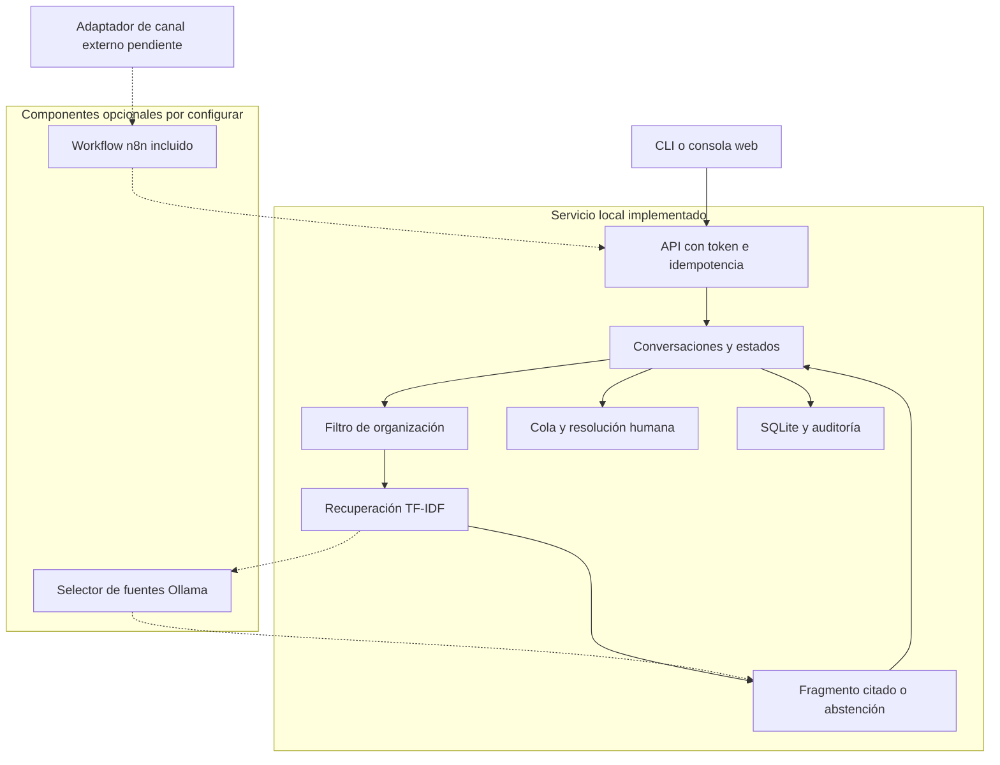

# Arquitectura

[Abrir SVG](diagrams/architecture.svg) · [Fuente Mermaid](diagrams/architecture.mmd)

Separa el canal de entrada, la conversación y la recuperación de políticas. El estado de atención se conserva junto a sus fuentes y al resultado de cada solicitud.

Versión Mermaid

Las líneas continuas muestran el recorrido implementado dentro de cada límite. Las líneas discontinuas indican componentes opcionales, entregados para configurar o aún por conectar; su estado se precisa en [tecnologías](technologies.md).

`conversations` conserva organización, canal, estado y marcas de escalamiento y cierre. `messages` guarda turnos con contactos comunes ocultos. Las políticas se almacenan en `documents` y `chunks` con versión. La consulta filtra organización y visibilidad pública antes de puntuar fragmentos.

Estados permitidos: `open → escalated → resolved`. Una respuesta con evidencia mantiene `open`; una petición explícita de atención o la falta de evidencia produce `escalated`. Un mensaje nuevo no saca automáticamente la conversación de la cola. El estado `resolved` requiere una nueva conversación para continuar.

El modelo opcional selecciona una fuente candidata; la respuesta final es el fragmento almacenado. Si el modelo devuelve un identificador desconocido, se abstiene. El texto del cliente y las políticas se tratan como datos, sin concederles herramientas ni cambios de estado.

El host ejecuta persistencia de mensajes, cambios de estado, auditoría e idempotencia en una misma transacción. La aplicación no envía notificaciones externas ni ejecuta herramientas administrativas sobre pedidos.

[Flujo de operación](flow.md) · [Tecnologías y alcance](technologies.md)
