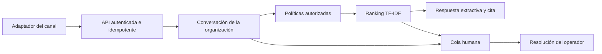

# Arquitectura

`conversations` conserva organización, canal, estado y marcas de escalamiento y cierre. `messages` guarda turnos con contactos comunes ocultos. Las políticas se almacenan en `documents` y `chunks` con versión. La consulta filtra organización y visibilidad pública antes de puntuar fragmentos.

Estados permitidos: `open → escalated → resolved`. Una respuesta con evidencia mantiene `open`; una petición explícita de atención o la falta de evidencia produce `escalated`. Un mensaje nuevo no saca automáticamente la conversación de la cola. El estado `resolved` requiere una nueva conversación para continuar.

El modelo opcional selecciona una fuente candidata; la respuesta final es el fragmento almacenado. Si el modelo devuelve un identificador desconocido, se abstiene. El texto del cliente y las políticas se tratan como datos, sin concederles herramientas ni cambios de estado.

El host ejecuta persistencia de mensajes, cambios de estado, auditoría e idempotencia en una misma transacción. La aplicación no envía notificaciones externas ni ejecuta herramientas administrativas sobre pedidos.
