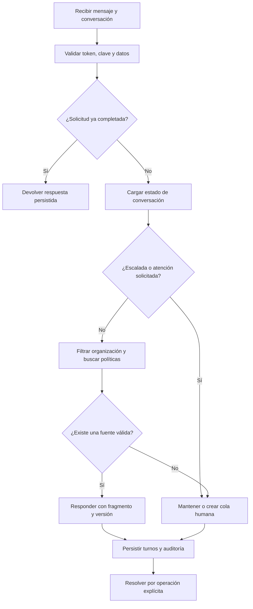

# Flujo de operación

[Abrir SVG](diagrams/flow.svg) · [Fuente Mermaid](diagrams/flow.mmd)

Versión Mermaid

- `message` conserva el canal de la conversación y rechaza continuar una conversación cerrada.
- `ask_human` no depende de disponibilidad del modelo; una conversación escalada sigue pendiente hasta `resolve`.
- Una respuesta citada mantiene el estado abierto: no demuestra por sí misma resolución del cliente.

Las operaciones del dominio se guardan junto a auditoría y respuesta idempotente en la transacción del servicio local. Un error revierte los cambios de esa solicitud.

[Arquitectura](architecture.md) · [Tecnologías y alcance](technologies.md)
